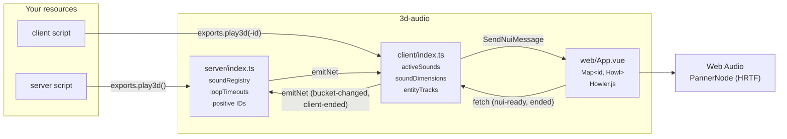
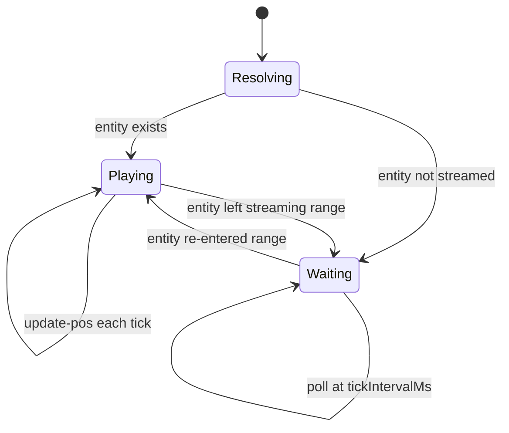
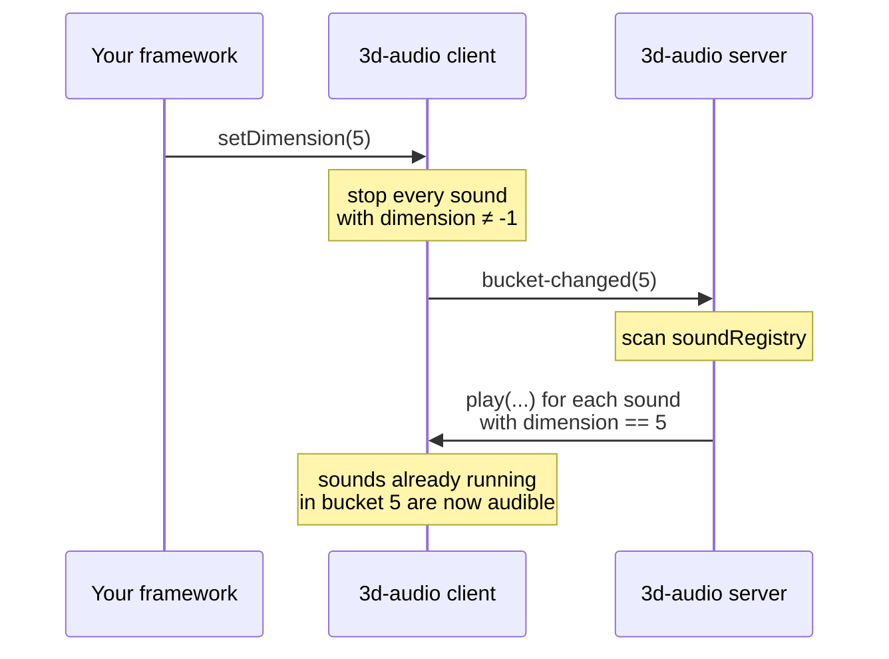
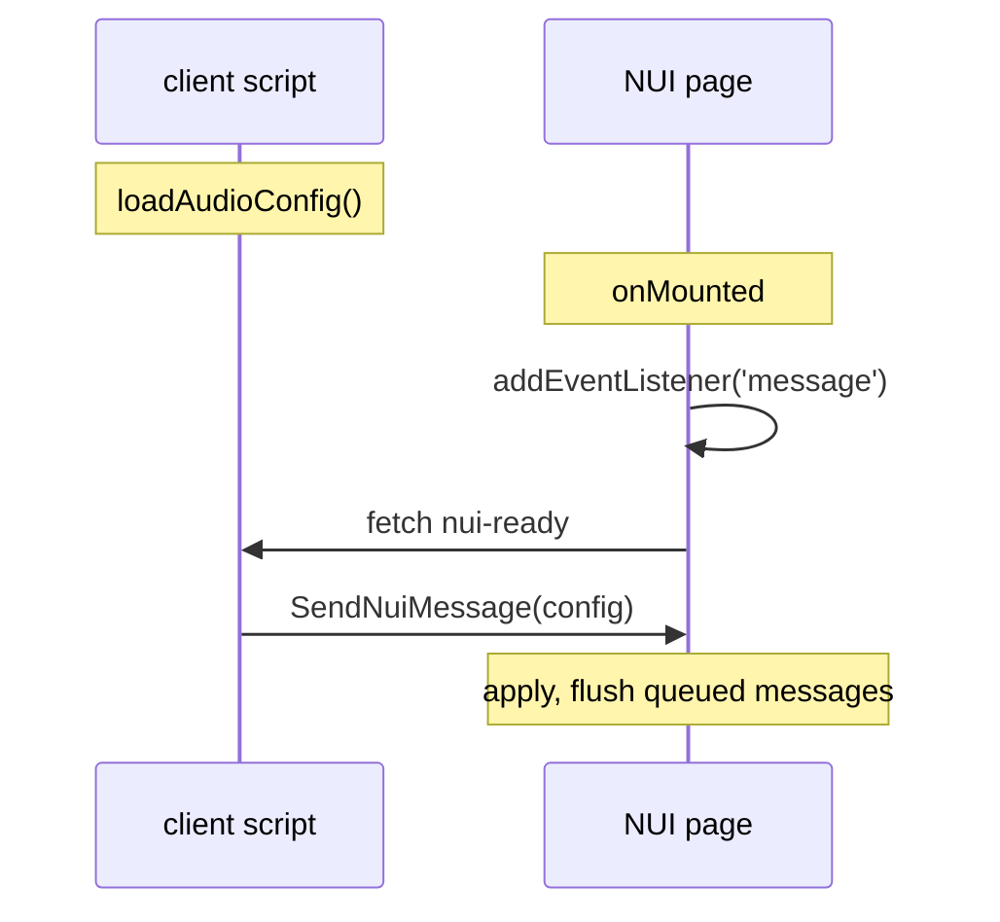

# Architecture

## Three layers

GTA V cannot play an arbitrary audio file at a world position. The browser can.
So the resource splits the job in three: the server decides *what* plays, the
client tracks *where* things are, and an invisible browser page does the actual
mixing.



| Layer | File | Job |
|---|---|---|
| Server | `src/server/index.ts` | Allocate IDs, keep the registry, fan out over the network, own loop timers, re-sync routing buckets |
| Client | `src/client/index.ts` | Filter by bucket, track entities, poll the listener pose, bridge to the NUI |
| NUI | `web/src/App.vue` | Hold one `Howl` per sound, set the panner, do the actual spatialization |

## The server is a registry, not a mixer

`play3d` on the server does three things: allocate a positive ID from a counter,
record the sound in `soundRegistry`, and `emitNet` it to the target.

The registry is the reason the server exists at all. Without it, a sound that
starts while you are in another routing bucket would be lost to you forever. With
it, the server can replay sounds on demand.

Entries leave the registry in one of three ways:

- `stop` is called
- a `loopDurationSeconds` timer fires
- the client reports the sound ended (`3d-audio:client-ended`)

An endless loop (`loop = true`, `loopDurationSeconds = 0`) matches none of these,
which is why it must be stopped by hand — see
[Known Limitations](limitations.md#3-endless-loops-leak-registry-entries).

## The listener tick

Spatialization needs to know where the player's ears are and which way they point.
There is no event for that, so the client polls:

```ts
listenerTick = setTick(async () => {
    if (activeSounds.size === 0 && entityTracks.size === 0) {
        clearTick(listenerTick!);   // self-cancel
        listenerTick = null;
        return;
    }
    const ped = PlayerPedId();
    const [px, py, pz] = GetEntityCoords(ped, true);
    const [rx, ry, rz] = GetEntityRotation(ped, 2);
    SendNuiMessage(/* 3d-audio:listener */);
    await new Promise(r => setTimeout(r, TICK_MS));
});
```

Two deliberate details:

- **It self-cancels.** When nothing is playing, the tick clears itself and the
  idle cost of the resource is zero. It is re-created lazily the next time a sound
  starts.
- **It runs at 20 Hz, not per frame.** `tickIntervalMs` defaults to `50`. Per-frame
  updates would be four or five times the work for no audible benefit: the Web
  Audio API interpolates between position updates, and the ear cannot resolve
  20 Hz stepping in a spatial image.

## Listener orientation

The subtlest code in the resource. GTA gives Euler angles in degrees; Web Audio
wants a normalised forward vector plus an up vector.

```ts
const yaw   = toRad(msg.rz)   // heading, 0° = North (+Y)
const pitch = toRad(msg.rx)   // positive = nose up
const fx = -Math.sin(yaw) * Math.cos(pitch)
const fy =  Math.cos(yaw) * Math.cos(pitch)
const fz =  Math.sin(pitch)
Howler.orientation(fx, fy, fz, 0, 0, 1)
```

GTA's heading convention is 0° = North (+Y), 90° = West, 180° = South, 270° = East,
which is why `fx` is negated and the sine and cosine are the way round they are.
The up vector is `(0, 0, 1)` because GTA's Z axis is vertical, unlike most 3D
engines where Y is up.

!!! note "Why not pass the angles directly"
    Handing raw angles to the `PannerNode` yields a zero-length forward vector
    when the player faces North. A zero vector is undefined behaviour for the
    panner and in practice silently breaks HRTF for every sound at once — the
    kind of bug that looks like "spatial audio just stopped working sometimes".

## Entity tracking

With `entityNetId > 0` the client starts a dedicated tick per sound:



`NetworkGetEntityFromNetworkId` only resolves while the entity is streamed to this
client, so the tick treats "not streamed" as "paused" rather than "ended": the
sound stops, and starts again from the beginning when the entity comes back. A
client that never streams the entity never hears the sound.

Each tracked sound costs one tick, which is what `limits.maxConcurrentSounds` is
really protecting.

## Routing bucket re-sync

FiveM has no client-side native for reading the local routing bucket, so this is
the one place the resource depends on the surrounding gamemode.



The consequence worth knowing: a sound is heard both by players already in the
bucket when it starts *and* by players who arrive later. Sounds with
`dimension = -1` are excluded from the replay, because they were already
broadcast to everyone and are never stopped by a bucket change.

Filtering happens on the **client**, not the server: the server emits to `target`
regardless of bucket, and the client drops what does not match. That works, but it
means dimension is **not a privacy boundary** — a modified client sees the play
messages for buckets it is not in.

## The NUI handshake

The browser page mounts well after the client script has run, and
`SendNuiMessage` sent before the frame exists is dropped with no error. So the
config cannot be pushed; it has to be pulled.



The NUI registers its message listener *before* asking, and queues anything that
arrives in the meantime, so no sound can be played with fallback panner settings
that differ from `config.json`. If the handshake never completes — running under
`vite dev`, or a resource restart ordering quirk — the page falls back to its own
copy of the defaults and flushes the queue anyway.

Those duplicated defaults in `web/src/config.ts` are a real risk of drift, so
`npm run check:config` compares them against `src/shared/config.ts` and
`config.json`, and CI fails if they disagree.

## Sound ID namespaces

| Sign | Allocated by | Lives in |
|---|---|---|
| Positive | the server, from a counter starting at 1 | `soundRegistry` on the server, `activeSounds` on the client |
| Negative | **the caller**, in client code | `activeSounds` on the client only |

Both share one `Map` in the NUI and one message format. The sign is what lets the
NUI's end-of-sound callback route correctly: negative IDs fire a local client
event, positive IDs report back to the server so the registry entry can be freed.

## The esbuild `exports` trap

Worth knowing if you fork this. In the client bundle:

```ts
// Use globalThis to prevent esbuild from shadowing FiveM's exports() with CommonJS exports
const exp = (globalThis as any).exports as (name: string, fn: (...args: any[]) => any) => void;
```

esbuild emits CommonJS, which defines a module-local `exports` object. That
shadows FiveM's global `exports()` function, and every export registration
silently becomes a property assignment on a module object nobody reads — the
resource starts fine and simply has no exports. Reaching through `globalThis`
avoids it.

The server bundle does not need the workaround, because it never got shadowed in
the same way, but the client one does.

## Build pipeline

```text
src/server/index.ts  ─┐
src/shared/*.ts      ─┼─ esbuild (platform: node)    → dist/server/index.js
                      │
src/client/index.ts  ─┤
src/shared/*.ts      ─┴─ esbuild (platform: browser) → dist/client/index.js

web/src/**           ─── vue-tsc + vite              → dist/web/
```

`src/shared/` is inlined into both game-script bundles, so there is no runtime
cost to sharing code and nothing extra to declare in the manifest. The NUI cannot
share it — different tsconfig, different module resolution, different target — so
it keeps its own copy of the defaults, guarded by the sync check.
